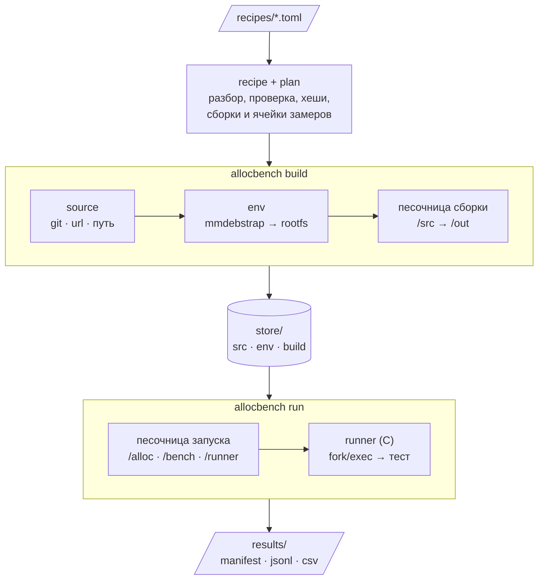

# allocbench

`allocbench` — инструмент для воспроизводимого сравнения аллокаторов памяти (glibc malloc, mimalloc, jemalloc, tcmalloc и др.) на наборе тестов.

Каждая сборка и каждый запуск выполняются в новом изолированном окружении: файловая система собирается из зафиксированного по дате rootfs Ubuntu, сети нет, переменные окружения хоста не видны.
Аллокаторы, тесты и окружения описываются простыми TOML-рецептами: чтобы добавить аллокатор, достаточно добавить файл, менять код или скрипты не нужно.
Docker и bash-скрипты не используются.

## Содержание

1. [Зачем](#зачем)
2. [Как это работает](#как-это-работает)
3. [Архитектура](#архитектура)
4. [Требования](#требования)
5. [Быстрый старт](#быстрый-старт)
6. [Рецепты](#рецепты)
7. [Хранилище](#хранилище)
8. [Прогон и результаты](#прогон-и-результаты)
9. [Проверка воспроизводимости](#проверка-воспроизводимости)
10. [Команды](#команды)
11. [Разработка](#разработка)

---

## Зачем

Результат сравнения аллокаторов зависит не только от самих аллокаторов, но и от всего, что их окружает:

| Что влияет | Пример |
| :--- | :--- |
| Компилятор и его версия | gcc 13 и gcc 14 по-разному оптимизируют тест |
| glibc | системный malloc (`sys`) — это malloc из glibc хоста; обновили систему — поменялся «системный аллокатор» |
| Версии исходников | `master` аллокатора сегодня и через месяц — разный код |
| Переменные окружения | `MALLOC_ARENA_MAX`, `LD_PRELOAD`, `CFLAGS` из профиля пользователя |
| Состояние машины | файлы и процессы от прошлого запуска |

`allocbench` фиксирует всё, что можно зафиксировать, и записывает то, что зафиксировать нельзя (ядро, процессор).
Цель — чтобы коллега на другой машине получил те же бинарники и сопоставимые цифры.

---

## Как это работает

1. **Рецепт** описывает, что собрать и как запустить. Исходники указываются точным коммитом (`rev`), плавающие версии запрещены.
2. **Окружение** (rootfs) создаётся `mmdebstrap` из снапшота архива Ubuntu на заданную дату. Одна и та же дата даёт одни и те же версии gcc и glibc сегодня и через год.
3. **Песочница** (`bwrap`) создаётся заново на каждое действие. Процесс видит только rootfs (только чтение) и нужные ему каталоги, сети нет.
4. **Хранилище** адресуется хешами входных данных. Если рецепт и исходники не менялись, сборка берётся готовой. Поменялся хотя бы байт — будет пересборка.
5. **Раннер** на C запускает тест через `fork`/`exec`/`wait4` и меряет время, пиковую память и page faults именно процесса теста.

---

## Архитектура



Сборка кладёт результаты в хранилище по хешу входов, прогон берёт их оттуда.
Каждая песочница — и сборки, и запуска — создаётся заново на одно действие: в ней только rootfs окружения (только чтение) и нужные этому действию каталоги.

| Компонент | Где | Что делает |
| :--- | :--- | :--- |
| CLI | `cmd/allocbench`, `internal/cli` | команды `list`, `build`, `shell`, `run`, `lock`, `verify` |
| Рецепты | `internal/recipe` | разбор TOML, `extends`, проверка полей, входные хеши |
| План | `internal/plan` | порядок сборок с учётом зависимостей, ячейки замеров |
| Хранилище | `internal/store` | адресация по хешу, блокировки, атомарная запись |
| Исходники | `internal/source` | скачивание и проверка исходников, хеш дерева файлов |
| Окружения | `internal/env` | создание rootfs через `mmdebstrap`, безопасная распаковка |
| Песочница | `internal/sandbox` | сборка аргументов `bwrap` |
| Сборка | `internal/build` | зависимости → исходники → окружение → песочница → хранилище |
| Раннер | `runner/runner.c`, `internal/runner` | замер одного запуска, протокол JSON |
| Ячейка | `internal/cell` | песочница запуска, `LD_PRELOAD`, таймаут, проверка вывода |
| Результаты | `internal/results` | `manifest.json`, `results.jsonl`, `results.csv`, сведения о машине |
| Lock-файл | `internal/lock` | хеши окружений и сборок, сверка с `allocbench.lock` |

---

## Требования

- Linux x86_64, ядро 5.3+, с разрешёнными непривилегированными user namespaces
- [bubblewrap](https://github.com/containers/bubblewrap) (`bwrap`)
- [mmdebstrap](https://gitlab.mister-muffin.de/josch/mmdebstrap) и запись пользователя в `/etc/subuid` и `/etc/subgid`
- `git`
- Go 1.22+ для сборки самого `allocbench`

Установка на Ubuntu/Debian:

```bash
sudo apt install bubblewrap mmdebstrap git golang
grep -q "^$USER:" /etc/subuid || echo "$USER:231072:65536" | sudo tee -a /etc/subuid /etc/subgid
```

Root не нужен ни для сборки окружений, ни для сборок, ни для запусков.

Подходит ли машина, показывает `allocbench doctor`:

```bash
$ ./allocbench doctor
ok       kernel           6.14.0-36-generic
ok       bwrap            /usr/bin/bwrap
ok       mmdebstrap       /usr/bin/mmdebstrap
ok       git              /usr/bin/git
ok       user namespaces  bwrap creates sandboxes
ok       /etc/subuid      user:231072:65536
ok       /etc/subgid      user:231072:65536
warning  cpu governor     powersave on 8 of 8 CPUs, the frequency follows the load
                          fix: echo performance | sudo tee /sys/devices/system/cpu/cpu*/cpufreq/scaling_governor
warning  turbo boost      enabled, the frequency depends on temperature
                          fix: echo 1 | sudo tee /sys/devices/system/cpu/intel_pstate/no_turbo
ok       core dumps       core
ok       huge pages       madvise
ok       memory           4.4 GB available
ok       load             0.31 over the last minute
ok       power            on mains
2 of 14 checks gave warnings, measurements will be noisy
```

Проверки бывают двух уровней:

- **error** — allocbench на этой машине работать не сможет: нет `bwrap`, `mmdebstrap` или `git`, ядро старше 5.3, выключены непривилегированные user namespaces, нет диапазона в `/etc/subuid` или `/etc/subgid`. Команда завершается с ошибкой.
- **warning** — работать можно, но замеры будут шумными: регулятор частоты не `performance`, включён турбобуст, падения передаются в apport или другой обработчик, THP в режиме `always`, свободно меньше 2 ГБ памяти, загрузка выше 1, ноутбук работает от батареи.

Под каждой проблемой стоит команда, которая её исправляет. Настройки частоты и THP сбрасываются при перезагрузке.

---

## Быстрый старт

```bash
git clone git@github.com:SolonenkoNikita/allocbench.git
cd allocbench
make build
```

Посмотреть рецепты:

```bash
$ ./allocbench list
KIND       NAME    VERSION  BUILD ENV  SOURCE                         HASH
env        gcc13   -        -          ubuntu noble 20260101T000000Z  c4d1894efccc
allocator  mi      v1.8.2   gcc13      git b66e3214d8a1               96bc9d605cbb
allocator  sys     -        -          -                              -
bench      cfrac   -        gcc13      git 69c41ed7e641               32b67fc7cfff
tool       runner  -        gcc13      path runner                    7d22fb868ef4
```

Собрать mimalloc и тест cfrac. В первый раз создаётся окружение, это занимает несколько минут:

```bash
$ ./allocbench build mi cfrac sys
fetching source of allocators/mi
creating environment gcc13, this takes a few minutes
building allocators/mi
fetching source of benches/cfrac
building benches/cfrac
RECIPE          STATUS            HASH          OUTPUT
allocators/mi   built             c05b0ff67bbd  /…/store/build/c05b0ff67bbd…
benches/cfrac   built             104a21e78121  /…/store/build/104a21e78121…
allocators/sys  nothing to build  -             -
```

Повторный запуск берёт всё из хранилища (`cached`).

Если снапшот Ubuntu временно недоступен, можно указать обычное зеркало (версии пакетов тогда не будут зафиксированы):

```bash
./allocbench build mi --mirror http://archive.ubuntu.com/ubuntu
```

Открыть оболочку в песочнице сборки, например, чтобы разобраться с упавшей сборкой:

```bash
./allocbench shell mi                      # интерактивный bash
./allocbench shell mi -- cmake --version   # одна команда
./allocbench shell gcc13                   # только окружение
```

Сравнить аллокаторы. `run` сам соберёт всё недостающее и выполнит каждую ячейку в новой песочнице:

```bash
$ ./allocbench run --alloc sys,mi --bench cfrac --repeat 3 --cpus 3
warning: cpu governor: powersave on 8 of 8 CPUs, the frequency follows the load
  fix: echo performance | sudo tee /sys/devices/system/cpu/cpu*/cpufreq/scaling_governor
warning: turbo boost: enabled, the frequency depends on temperature
  fix: echo 1 | sudo tee /sys/devices/system/cpu/intel_pstate/no_turbo
host: Intel(R) Core(TM) i5-10310U CPU @ 1.70GHz, 8 CPUs, amd64, kernel 6.14.0-36-generic
pinned to CPUs 3
running 6 cells, results in results/20261113T162559Z
[1/6] cfrac/sys/t1/r0              ok             7.758s   3.1 MB
[2/6] cfrac/mi/t1/r0               ok             7.206s   3.1 MB
[3/6] cfrac/sys/t1/r1              ok             7.428s   3.2 MB
[4/6] cfrac/mi/t1/r1               ok             6.788s   3.1 MB
[5/6] cfrac/sys/t1/r2              ok             7.548s   3.1 MB
[6/6] cfrac/mi/t1/r2               ok             6.748s   3.1 MB

BENCH  THREADS  ALLOC  OK   MEDIAN  MIN     MAX     RELATIVE  MAX RSS
cfrac  1        sys    3/3  7.548s  7.428s  7.758s  1.00      3.1 MB
cfrac  1        mi     3/3  6.788s  6.748s  7.206s  0.90      3.1 MB
```

`RELATIVE` — медиана времени относительно первого аллокатора в списке: удобно ставить `sys` первым.
`--cpus 3` закрепляет тесты на третьем ядре. Предупреждения в начале — те же, что показывает `allocbench doctor`: замер идёт, но на шумной машине.

---

## Рецепты

Рецепт — TOML-файл в `recipes/<вид>/<имя>.toml`. Имя рецепта — имя файла.
Рецепты проверяются строго: опечатка в имени поля, короткий хеш коммита или ссылка на несуществующее окружение — это ошибка с указанием рецепта, а не тихо проигнорированная настройка.

### Окружение: `recipes/envs/gcc13.toml`

```toml
distro   = "ubuntu"
suite    = "noble"
snapshot = "20260101T000000Z"
packages = ["build-essential", "gcc-13", "g++-13", "cmake", "ninja-build"]
```

### Аллокатор: `recipes/allocators/mi.toml`

```toml
version   = "v1.8.2"
build_env = "gcc13"

[source]
git    = "https://github.com/microsoft/mimalloc"
rev    = "b66e3214d8a104669c2ec05ae91ebc26a8f5ab78"
sha256 = "a27f09204d8273efed245a8ed7093fd062d65b1a14fb0fa121e375b96b5aff3d"

[build]
script = '''
cmake -S /src -B . -G Ninja $CMAKE_FLAGS
ninja -j "$JOBS"
install -Dm755 libmimalloc.so /out/lib/libmimalloc.so
'''
vars = { CMAKE_FLAGS = "-DCMAKE_BUILD_TYPE=Release -DMI_BUILD_TESTS=OFF" }

[use]
preload = "lib/libmimalloc.so"
```

Системный аллокатор — пустой файл `recipes/allocators/sys.toml`: собирать нечего, используется malloc из glibc окружения.

Вариант аллокатора наследует всё от родителя и переопределяет только отличия:

```toml
extends = "mi"

[build]
vars = { CMAKE_FLAGS = "-DCMAKE_BUILD_TYPE=Release -DMI_SECURE=ON" }
```

### Тест: `recipes/benches/cfrac.toml`

```toml
build_env = "gcc13"

[source]
git    = "https://github.com/daanx/mimalloc-bench"
rev    = "69c41ed7e6419fb5d362eb04ba34b850ec89dc8e"
sha256 = "2ff71f5e3b39d6467d199eac07f794e1bf80e140030a6e082fdefd27af022fd2"

[build]
script = '''
cd /src/bench/cfrac
mkdir -p /out/bin
gcc $CFLAGS -o /out/bin/cfrac \
    cfrac.c pops.c pconst.c pio.c \
    pabs.c pneg.c pcmp.c podd.c phalf.c \
    padd.c psub.c pmul.c pdivmod.c psqrt.c ppowmod.c \
    atop.c ptoa.c itop.c utop.c ptou.c errorp.c \
    pfloat.c pidiv.c pimod.c picmp.c \
    primes.c pcfrac.c pgcd.c -lm
'''
vars = { CFLAGS = "-O3 -DNDEBUG -std=gnu89 -DNOMEMOPT=1 -w" }

[run]
cmd     = ["/bench/bin/cfrac", "17545186520507317056371138836327483792789528"]
timeout = "5m"
threads = [1]

[check]
stdout_sha256 = "99eb4f7b4392295adfe8b8d257802f910cdbc1eaf9b8f8785c6b62fc32229ef6"
```

Скрипты пишутся в `'''`: внутри них TOML ничего не экранирует, и `\` в конце строки доходит до shell как перенос.

### Основные поля

| Поле | Где | Описание |
| :--- | :--- | :--- |
| `build_env` | аллокатор, тест, инструмент | окружение, в котором идёт сборка |
| `source.git` + `source.rev` | | репозиторий и полный хеш коммита (40 символов) |
| `source.url` + `source.sha256` | | архив и его хеш |
| `source.path` | | локальный каталог относительно корня проекта |
| `source.sha256` | при `git` | необязательный хеш дерева файлов после checkout |
| `source.patches` | | патчи, применяются через `git apply` |
| `build.script` | | скрипт `sh -eu`; исходники в `/src` (только чтение), рабочий каталог `/build`, результат кладётся в `/out` |
| `build.vars` | | переменные для скрипта |
| `build.deps` | | инструменты из `recipes/tools`; монтируются в `/deps/<имя>`, их `bin` добавляется в `PATH` |
| `use.preload` | аллокатор | путь к библиотеке внутри результата сборки для `LD_PRELOAD` |
| `run.cmd`, `run.timeout`, `run.threads` | тест | команда запуска, таймаут, число потоков (каждое значение — отдельная ячейка) |
| `check.stdout_sha256` | тест | ожидаемый хеш вывода: аллокатор не должен ломать программу |
| `extends` | аллокатор, тест | наследование от другого рецепта того же вида |

В скрипте сборки всегда доступны `JOBS` (флаг `-j`), `SOURCE_DATE_EPOCH` (дата снапшота окружения) и `HOME=/build`.

---

## Хранилище

По умолчанию `./store`, задаётся флагом `--store`.

```
store/
├── src/<ключ>/            исходники
├── env/<хеш>/rootfs/      распакованный rootfs окружения
├── env/<хеш>/env.json     хеш содержимого rootfs и зеркало
├── build/<хеш>/           результаты сборок (то, что скрипт положил в /out)
├── logs/                  логи сборок и создания окружений
├── tmp/                   незавершённые записи
└── locks/                 блокировки
```

- Запись появляется в хранилище только целиком: всё пишется в `tmp/`, затем атомарно переименовывается.
- Упавшая сборка в хранилище не попадает. В сообщении об ошибке выводится конец лога и путь к полному логу.
- Ключ сборки учитывает рецепт после `extends`, окружение, содержимое исходников и патчей, а также ключи зависимостей. Правка локального файла или зависимости вызывает пересборку.
- Хранилище можно удалить целиком: всё пересоздастся при следующем запуске.

---

## Прогон и результаты

Ячейка — один замер: аллокатор × тест × число потоков × номер повтора.
Каждая ячейка выполняется в новой песочнице. Раннер на C запускает тест, передаёт только ему `LD_PRELOAD` и переменные аллокатора и меряет время, пиковую память и page faults.

По умолчанию ячейки чередуются (`sys`, `mi`, `sys`, `mi`, …), чтобы медленный дрейф машины не доставался одному аллокатору.
Упавший тест, таймаут или неверный вывод не прерывают прогон: ячейка получает статус, а команда в конце завершается с ошибкой.

Прогон можно прервать через Ctrl-C или `kill`. Текущая ячейка останавливается и не попадает в результаты. Готовые ячейки остаются в `results.jsonl` и сводке, а в `manifest.json` появляется `"interrupted": true`. Команда завершается с кодом 130.
Так же останавливаются сборки, создание окружения и скачивание исходников: недоделанное в хранилище не остаётся.
Повторное нажатие Ctrl-C завершает allocbench сразу, не дожидаясь остановки дочерних процессов.
Перед запуском библиотеки аллокатора и бинарники теста проверяются на совместимость с окружением запуска: если им нужна библиотека или версия символа (`GLIBC_2.40`, `GLIBCXX_3.4.33`), которой там нет, ячейка не запускается и получает статус `incompatible` с причиной.

План можно задать флагами или файлом, флаги переопределяют файл:

```toml
allocators = ["sys", "mi"]
benches    = ["cfrac"]
run_env    = "gcc13"
repeat     = 5
order      = "interleaved"
cpus       = "2-5"
```

```bash
./allocbench run --plan plan.toml
./allocbench run --plan plan.toml --repeat 10
./allocbench run --alloc all --bench all
```

`cpus` (или `--cpus`) закрепляет тест на перечисленных ядрах: список вида `2-5,7`. Без закрепления планировщик переносит тест между ядрами, и разброс растёт.
Раннер вызывает `sched_setaffinity` до запуска теста, поэтому закрепление действует на тест и все его потоки и дочерние процессы.
Ядра должны быть доступны самому `allocbench`: если процесс уже ограничен через `taskset` или cgroup, ядра вне этого набора — ошибка до начала сборок.
Для замеров лучше брать ядра, на которых меньше всего фоновой работы, и не брать соседние гиперпотоки одного физического ядра.

Перед первой ячейкой `run` выводит предупреждения о шумных условиях: проверки `allocbench doctor` (частота, турбобуст, обработчик падений, THP, память, загрузка, питание), отсутствие закрепления и тесты, которым потоков больше, чем ядер.
Прогон с предупреждениями не останавливается: они печатаются в stderr и записываются в `manifest.json`.

Результаты складываются в `results/<время UTC>/`:

```
results/20261112T200539Z/
├── manifest.json        версия allocbench, план, окружение запуска, хеши всех сборок, параметры машины
├── results.jsonl        одна строка JSON на ячейку
├── results.csv          то же таблицей, для графиков
├── summary.txt          сводка, как в терминале
└── cells/cfrac/mi/t1/r0/
    ├── stdout, stderr   вывод теста
    ├── result.json      замер раннера
    └── sandbox.log      вывод песочницы
```

Поля замера:

| Поле | Описание |
| :--- | :--- |
| `status` | `ok`, `exit code N`, `killed by signal N`, `timeout`, `exec error: …`, `wrong output`, `incompatible: …` |
| `wall_ns` | реальное время выполнения |
| `user_us`, `sys_us` | время CPU в пространстве пользователя и в ядре |
| `max_rss_kb` | пиковая резидентная память |
| `minflt`, `majflt` | page faults без чтения с диска и с чтением |
| `nvcsw`, `nivcsw` | добровольные и принудительные переключения контекста |
| `stdout_sha256` | хеш вывода; сверяется с `check.stdout_sha256` рецепта |

В `manifest.json` записываются ядро, модель CPU, число ядер, доступные процессу ядра (`allowed_cpus`), объём памяти, режим transparent huge pages, `cpu governor` и `overcommit_memory`: rootfs их не фиксирует, а на результат они влияют.
Там же лежат закреплённые ядра (`plan.cpus`) и предупреждения прогона (`warnings`).

Два прогона сравнивает `allocbench diff`.
Сначала выводится, чем различались условия: параметры машины, окружение запуска, хеши сборок, план и предупреждения. Время начала и конца не сравнивается. Затем — как изменились медианы:

```bash
$ ./allocbench diff results/20261113T194850Z results/20261113T195132Z
A: results/20261113T194850Z
B: results/20261113T195132Z

conditions differ in 4 places:
  plan.cpus  - -> 3
  warnings   - load: 3.58 over the last minute, other processes compete for CPUs
             - cpus: not pinned, the scheduler moves benches between CPUs
             + load: 4.49 over the last minute, other processes compete for CPUs

BENCH  THREADS  ALLOC  A       B       CHANGE
cfrac  1        sys    8.280s  8.298s  +0.2%
cfrac  1        mi     7.534s  7.253s  -3.7%
```

`-` означает, что значения нет: поле отсутствует, сборки нет или у группы нет успешных ячеек.
Если результаты двух прогонов расходятся, по первой части видно, можно ли их вообще сравнивать.

---

## Проверка воспроизводимости

`allocbench.lock` хранит для каждого окружения хеш содержимого rootfs, а для каждой сборки — входной хеш и хеш того, что получилось в `/out`.
Файл лежит рядом с каталогом `recipes/` и коммитится вместе с рецептами.

```bash
./allocbench lock            # собрать всё и записать allocbench.lock
./allocbench lock mi         # обновить только mi и его окружение
./allocbench lock --check    # сверить свои сборки с allocbench.lock
```

```toml
[envs.gcc13]
  hash = "c4d1894efccc…"   # рецепт окружения
  tree = "…"               # содержимое rootfs

[builds."allocators/mi"]
  hash = "c05b0ff67bbd…"   # входы сборки
  out = "e4b6bdc87b83…"    # содержимое /out
```

`--check` различает два вида расхождений:

| Сообщение | Что значит |
| :--- | :--- |
| `inputs changed since the lock` | рецепт или исходники поменялись, lock устарел — перезапустить `allocbench lock` |
| `output differs from the lock` | входы те же, а результат другой: сборка зависит от чего-то незафиксированного |
| `rootfs differs from the lock` | из того же рецепта окружения получился другой rootfs |

Окружение, созданное с `--mirror` вместо снапшота, на другой машине почти наверняка соберётся иначе: `lock` об этом предупреждает.

`allocbench verify` собирает рецепт дважды с нуля, второй раз с другим `JOBS`, и сравнивает результаты по файлам.
Если сборка уже есть в хранилище, свежий результат сравнивается и с ней.

```bash
$ ./allocbench verify mi cfrac
allocators/mi: reproducible, out e4b6bdc87b83, same as the store
benches/cfrac: reproducible, out e362c4a97aa8, same as the store
```

При расхождении выводится список отличающихся файлов, а с `--keep` обе сборки остаются на диске для сравнения, например через `diffoscope`.

---

## Команды

| Команда | Описание |
| :--- | :--- |
| `allocbench list` | таблица рецептов с входными хешами |
| `allocbench build <рецепт>...` | собрать рецепты и их зависимости; рецепт — `mi` или `allocators/mi` |
| `allocbench shell <рецепт> [-- команда]` | оболочка в песочнице сборки рецепта или в окружении |
| `allocbench run` | собрать всё нужное плану и выполнить ячейки; флаги `--plan`, `--alloc`, `--bench`, `--run-env`, `--repeat`, `--order`, `--cpus`, `--results` |
| `allocbench lock [рецепт]...` | записать хеши окружений и сборок в `allocbench.lock`; с `--check` — сверить с ним |
| `allocbench verify [рецепт]...` | собрать дважды и сравнить результаты по файлам |
| `allocbench doctor` | проверить, подходит ли машина для сборок и замеров |
| `allocbench diff <прогон> <прогон>` | сравнить условия и медианы двух прогонов |

Общие флаги:

| Флаг | По умолчанию | Описание |
| :--- | :--- | :--- |
| `--recipes` | `recipes` | каталог рецептов |
| `--store` | `store` | каталог хранилища |
| `--mirror` | снапшот из рецепта | другое зеркало пакетов |
| `--proxy` | из `https_proxy` / `http_proxy` | прокси для скачивания пакетов |
| `-v`, `--verbose` | выключен | показывать вывод сборки и `mmdebstrap` |

---

## Разработка

```bash
make build    # собрать ./allocbench
make test     # все тесты
```

Тесты песочницы, сборки и раннера запускают настоящий `bwrap` и компилятор C. Если их нет, такие тесты пропускаются.
Сеть и `mmdebstrap` в тестах не используются: окружение подменяется rootfs хоста.
